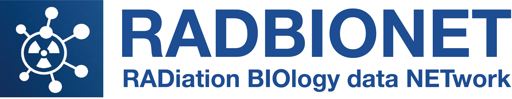

# RadBioNet 

**RadBioNet** (Radiation Biology Network) is an interactive Shiny web application that serves as a curated database for radiation biology research. It was developed by the **Department of Radiation Oncology** at **Ruijin Hospital**, Shanghai JiaoTong University School of Medicine.

The platform collects, visualizes, and allows exploration of factors associated with **radiation sensitivity and resistance** in cancer, supporting the global radiation oncology research community.

## Web Access

- **Website**: [https://radbionet.com](https://radbionet.com)

## Features

### Data Exploration (Data Tab)

- Filter by **Tumor Type**, **Tumor Subtype**, **Radiation Type**, **Factor Type**, and **Evidence Level**
- Interactive proportion pie charts with counts and percentages for each category
- Sortable, searchable data table with export to CSV, Excel, and print
- Color-coded relationship indicators (sensitive vs. resistance)

### Clinical Samples (Clinical Tab)

- Distribution of effect directions (radiosensitization, radioresistance, etc.)
- Cross-tabulation of evidence levels by tumor type

### Chat-Radbio (AI Assistant)

- Built-in conversational AI assistant specialized in radiation biology
- Supports local LLM (Ollama) or cloud API (DeepSeek, SiliconFlow, Groq, etc.)
- Markdown rendering for formatted responses (bold, code, links, lists)

## Tech Stack

- **Language**: R
- **Framework**: R Shiny
- **UI**: shinydashboard, shinyWidgets, shinyjs
- **Visualization**: ggplot2, plotly, DT
- **Data**: dplyr, data.table
- **AI Integration**: httr, jsonlite (OpenAI-compatible API / Ollama)

## Project Structure

```
radbionet/
├── global.R              # Package imports, data loading, global variables
├── ui.R                  # Shiny UI: navbar with 5 tabs
├── server.R              # Server logic dispatcher
├── functions/
│   ├── utils.R           # UI helper functions & Markdown renderer
│   ├── plot_functions.R  # Proportion pie chart generators
│   └── llm.R             # LLM API functions (Ollama / OpenAI-compatible)
├── tabs/
│   ├── ui/               # UI definitions per tab
│   └── server/           # Server logic per tab
├── config/
│   └── llm_config.R.example  # LLM configuration template
├── dados/
│   └── sensitive_resistance.xlsx  # Core database
└── www/
    ├── styles.css
    └── img/              # Logos and images
```

## Local Development

### Prerequisites

- R (>= 4.0)
- R packages: `shiny`, `dplyr`, `data.table`, `ggplot2`, `plotly`, `DT`, `shinyWidgets`, `shinyjs`, `httr`, `jsonlite`

### Run

```r
shiny::runApp()
```

### Chat-Radbio Configuration

The AI chat supports two backends:

1. **Local (Ollama)**: Install [Ollama](https://ollama.com), pull a model:
   ```bash
   ollama pull qwen2.5:7b
   ollama serve
   ```

2. **Cloud API**: Set environment variables or configure via UI (gear icon):
   ```bash
   export RADBIO_API_URL=https://api.deepseek.com
   export RADBIO_API_KEY=sk-your-key
   export RADBIO_MODEL=deepseek-chat
   ```

## Data

The database contains curated records of factors influencing radiation response in cancer, including:

- Tumor types and subtypes
- Radiation types and doses
- Molecular factors (genes, proteins, pathways, compounds)
- Effect directions (sensitization, resistance)
- Evidence levels (clinical trials, patient data, animal models, cell lines)

## Citation

If you use RadBioNet in your research, please cite:

> Department of Radiation Oncology, Ruijin Hospital, Shanghai JiaoTong University. RadBioNet: Radiation Biology Network. https://radbionet.com

## Contact

**Department of Radiation Oncology**  
Ruijin Hospital, Shanghai JiaoTong University School of Medicine  
Shanghai, China
