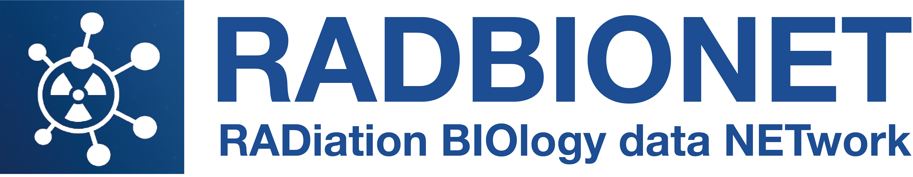

# RadBioNet 

**RadBioNet** (Radiation Biology Network) is a curated database and interactive Shiny web application for radiation oncology research. It is developed by the **Department of Radiation Oncology** at **Ruijin Hospital**, Shanghai JiaoTong University School of Medicine.

RadBioNet brings together experimental and clinical evidence on factors that modulate **radiation sensitivity and resistance** in cancer, and provides tools for filtering, visualization, and analysis.

## Web Access

- **Website**: [https://radbionet.com](https://radbionet.com)

## What The Database Covers

The database is centered on **factor–radiation response** relationships and includes:

- **Cancer type and subtype** (curated tumor categories)
- **Radiation modality / particle type** (e.g., photons, protons, heavy ions)
- **Factor type** (gene/protein, pathway, drug, nanoparticle, transcription factor, etc.)
- **Direction of effect** (radiosensitization vs. radioresistance)
- **Evidence type** (cell lines, animal models, patient cohorts, clinical data)
- **Quality flag** (curation confidence)
- **Biological mechanism** summaries
- **Publication metadata** (title, journal, year, DOI)

These fields are visible in the **Data** tab and power all filtering and visualization features.

## Key Features

### Data (Primary Database)

- Multi-filter search across cancer type, particle type, factor type, direction, evidence, and quality
- Fast searchable table with CSV/Excel export
- Clickable factor names → detailed factor page
- Clickable DOI links to the original publications

### Analysis

- Timeline trends for selected factors
- Modality and equipment statistics
- Dose distribution summaries
- Knowledge graph of factor relationships

### Chat-Radbio (AI Assistant)

- LLM-based Q&A focused on radiation biology
- Supports local Ollama models or OpenAI-compatible APIs

## How To Use

1. **Open the Data tab** to explore the full database.
2. Use the filter cards to narrow by tumor type, particle type, factor type, direction, evidence, and quality.
3. Use the search box in the table for keyword-based filtering.
4. Click a **factor name** to open its detail page and related publications.
5. Go to **Analysis** for summary charts and trend exploration.

## Data Sources & Curation

- Records are curated manually from published literature.
- Each entry links to a DOI whenever available.
- Quality flags reflect the curation confidence and evidence strength.

## Tech Stack

- **Language**: R
- **Framework**: R Shiny
- **UI**: shinydashboard, shinyWidgets, shinyjs
- **Visualization**: ggplot2, plotly, DT
- **Data**: dplyr, data.table
- **AI Integration**: httr, jsonlite (OpenAI-compatible API / Ollama)

## Project Structure

```
radbionet/
├── global.R              # Package imports, data loading, global variables
├── ui.R                  # Shiny UI: navbar with tabs
├── server.R              # Server logic dispatcher
├── functions/
│   ├── utils.R           # UI helper functions & utilities
│   ├── plot_functions.R  # Plotly chart generators
│   └── llm.R             # LLM API functions (Ollama / OpenAI-compatible)
├── tabs/
│   ├── ui/               # UI definitions per tab
│   └── server/           # Server logic per tab
├── config/
│   └── llm_config.R.example  # LLM configuration template
├── dados/
│   ├── factor_v4_proton_therapy.rds   # Core database (RDS)
│   └── factor_v4_proton_therapy.xlsx  # Core database (Excel)
└── www/
    ├── styles.css
    └── img/              # Logos and images
```

## Local Development

### Prerequisites

- R (>= 4.0)
- R packages: `shiny`, `dplyr`, `data.table`, `ggplot2`, `plotly`, `DT`, `shinyWidgets`, `shinyjs`, `httr`, `jsonlite`

### Run

```r
shiny::runApp()
```

### Chat-Radbio Configuration

The AI chat supports two backends:

1. **Local (Ollama)**: Install [Ollama](https://ollama.com), pull a model:
   ```bash
   ollama pull qwen2.5:7b
   ollama serve
   ```

2. **Cloud API**: Set environment variables or configure via UI (gear icon):
   ```bash
   export RADBIO_API_URL=https://api.deepseek.com
   export RADBIO_API_KEY=sk-your-key
   export RADBIO_MODEL=deepseek-chat
   ```

## Citation

If you use RadBioNet in your research, please cite:

> Department of Radiation Oncology, Ruijin Hospital, Shanghai JiaoTong University. RadBioNet: Radiation Biology Network. https://radbionet.com

## Contact

**Department of Radiation Oncology**  
Ruijin Hospital, Shanghai JiaoTong University School of Medicine  
Shanghai, China
