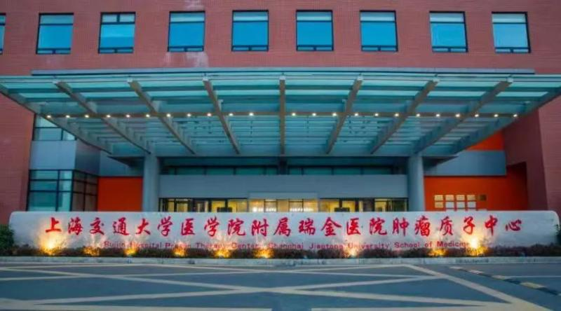

<!-- 内联样式直接控制 -->
<h1 style="font-size: 2rem; line-height: 1.2;">
  上海交通大学医学院附属瑞金医院肿瘤（质子）中心
</h1>

<!-- Duas colunas -->

### 

国产首台质子治疗系统（SAPT-PS-01）2023年7月19日在瑞金质子中心开启试运行，收费标准获批后于2023年11月24日开始正式运营。自2024年3月26日瑞金医院质子治疗取得100例突破以来，至今已完成收治600例。

***

瑞金医院质子设备获批适应症为恶性肿瘤和部分良性肿瘤，治疗病种已从临床试验阶段的11种扩展至目前的近50种，全面涵盖常见放疗适应症和临床应用场景。放疗和手术、药物治疗并列为肿瘤的三大治疗手段。70%的肿瘤患者需要接受放疗，放疗对肿瘤生存率的贡献高达22%。从理论上讲，所有适合传统光子放射治疗的患者均可接受质子治疗。质子治疗精准性和低副作用特点，使其在儿童肿瘤、中枢神经系统肿瘤、头颈部肿瘤、再程放疗、复杂解剖部位的肿瘤、以及乳腺癌、前列腺癌、淋巴瘤等需要避免长期副作用的患者群体中更具疗效和安全性的双重优势。

***

  <a href="https://www.linkedin.com/in/augusto-marcolin-1114a1b5/"> 
    <i class="fa fa-linkedin" style='font-size:20px; margin: 0px 5px'></i>
  </a>
  <a href="https://github.com/augustomarcolin"> 
    <i class="fa fa-github" style='font-size:20px; margin: 0px 5px'></i>
  </a>
  <a href="https://twitter.com/"> 
    <i class="fa fa-twitter" style='font-size:20px; margin: 0px 5px'></i>
  </a>

