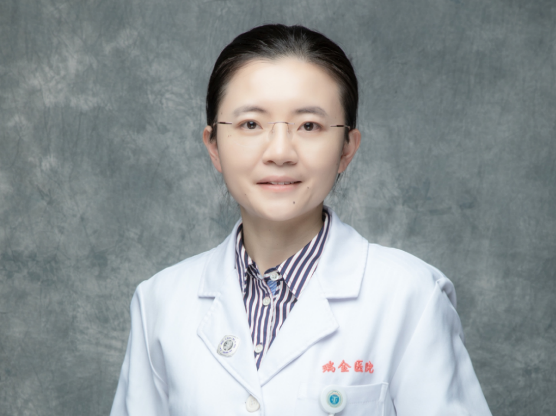

<h1 style="font-size: 2rem; line-height: 1.2;">
  曹璐
</h1>

上海交大医学院附属瑞金医院放疗科，科副主任，副主任医师，硕士生导师

长期致力于乳腺癌放射治疗和肿瘤心脏病学研究

以第一/通讯作者身份发表SCI及核心期刊论文30余篇。主持国自然青年及面上项目、上海市卫计委课题。曾获上海交通大学医学院“九龙奖”，上海医学科普新锐之星，第三届“人民好医生”(乳腺癌) ，上海市“医苑新星”优秀学员，上海市卫健委五四青年，瑞金医院青联委员等

***

### 担任：

* 上海市医学会肿瘤放疗专科分会 委员兼秘书
* 中国抗癌协会整合肿瘤心脏病分会委员
* 中国抗癌协会肿瘤粒子治疗专业委员会 委员 
* CSCO乳腺癌专委会 委员
* 上海市抗癌协会乳腺癌专业委员会 青年委员

***

  <a href="https://www.linkedin.com/in/felipe-nunes-31772453/"> 
    <i class="fa fa-linkedin" style='font-size:20px; margin: 0px 5px'></i>
  </a>
  <a href="https://github.com/DouglasMesquita"> 
    <i class="fa fa-github" style='font-size:20px; margin: 0px 5px'></i>
  </a>
  <a href="https://twitter.com/"> 
    <i class="fa fa-twitter" style='font-size:20px; margin: 0px 5px'></i>
  </a>

