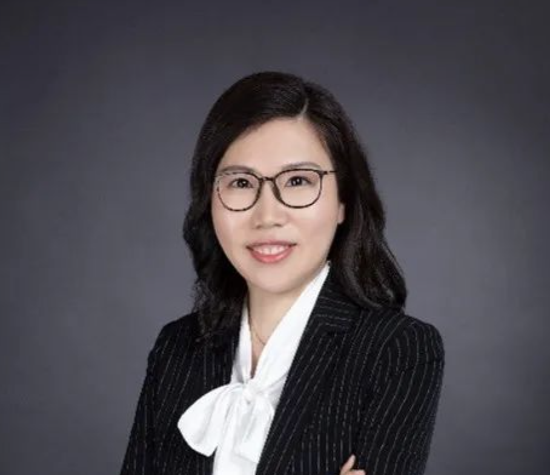

<h1 style="font-size: 2rem; line-height: 1.2;">
  林盈盈
</h1>

<!-- Duas colunas -->

上海交通大学医学院附属瑞金医院研究员,从事放射治疗尤其是质子放疗效应机制研究，聚焦神经系统的放射生物学和正常脑组织损伤修复。以通讯或第一作者（共同）在Journal of Clinical Investigation、Neuro-Oncology、JNCI-Journal of the National Cancer Institute、Cancer Immunology Research、Cancer Letters等杂志共发表20余篇JCR/Q1区论文；申报8项国家发明专利；相继获得国家自然科学基金-青年项目，面上项目（2017、2022），科技部重点专项（骨干）和上海市科委等多个项目支持；入选上海交通大学晨星计划和上海市青年英才扬帆计划；

***

### 担任：

* 上海市抗癌协会神经肿瘤专业委员会
* 中国研究型医院学会医学动物实验专家委员会委员
* 中西医结合委再生医学全国专业组委员
* Oncology Research 编委
* VIEW青年编委
* Cancer Research、Cancer Letters、Trends in Molecular Medicine等期刊审稿人

***

  <a href="https://www.linkedin.com/in/godoy-lucas/"> 
    <i class="fa fa-linkedin" style='font-size:20px; margin: 0px 5px'></i>
  </a>
  <a href="https://github.com/lcgodoy"> 
    <i class="fa fa-github" style='font-size:20px; margin: 0px 5px'></i>
  </a>
  <a href="https://twitter.com/godoy_lusca"> 
    <i class="fa fa-twitter" style='font-size:20px; margin: 0px 5px'></i>
  </a>

